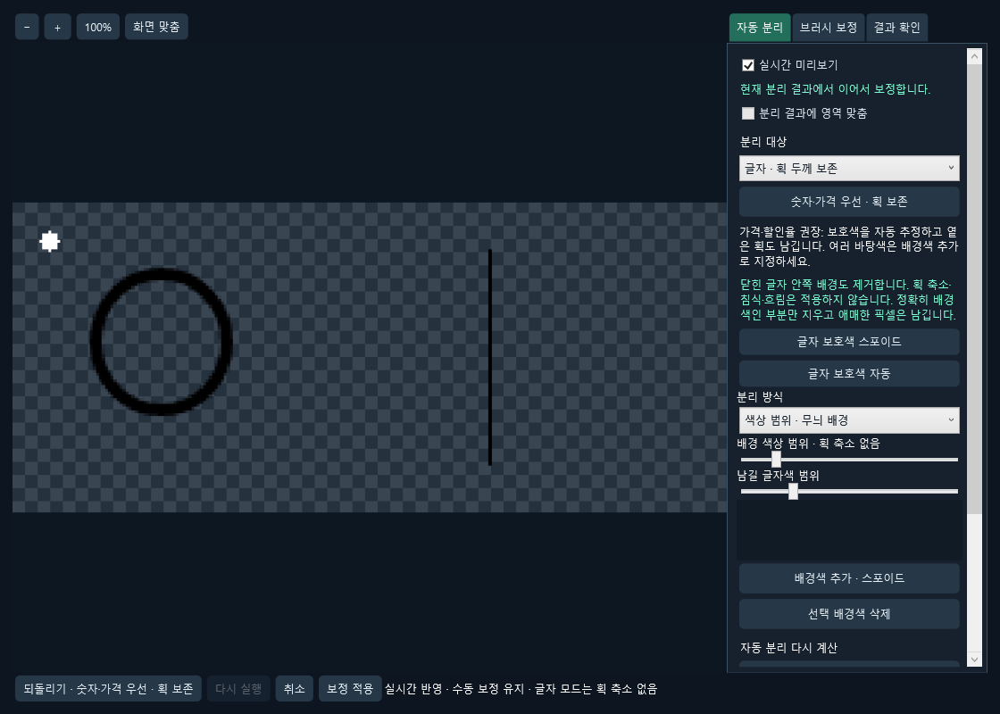
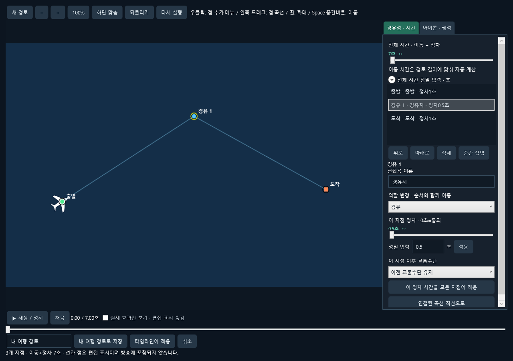
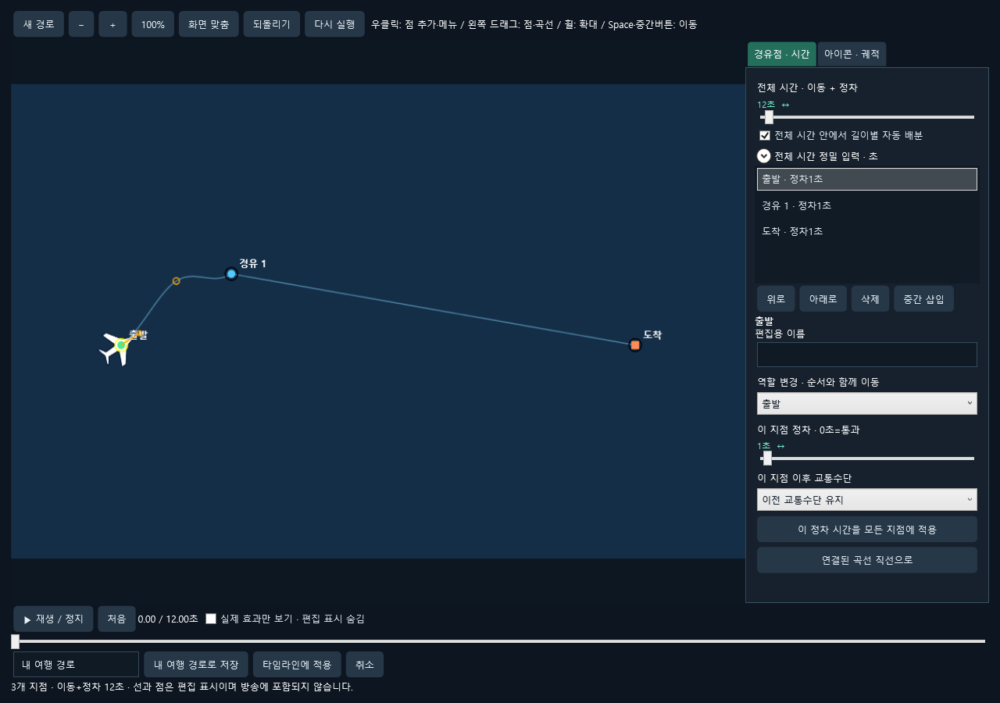
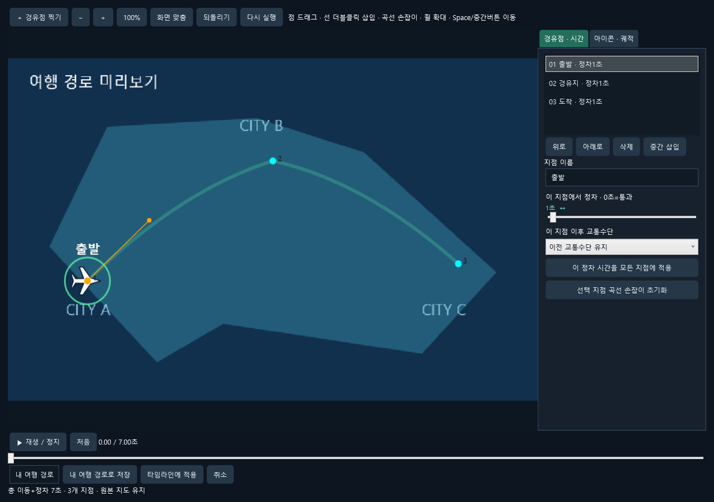
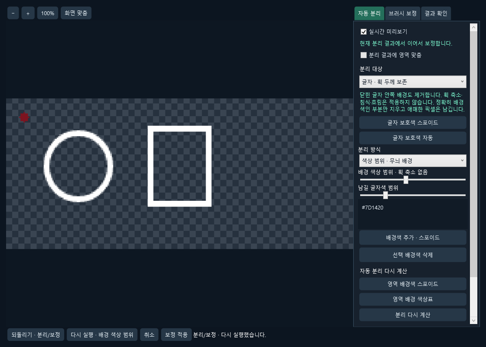
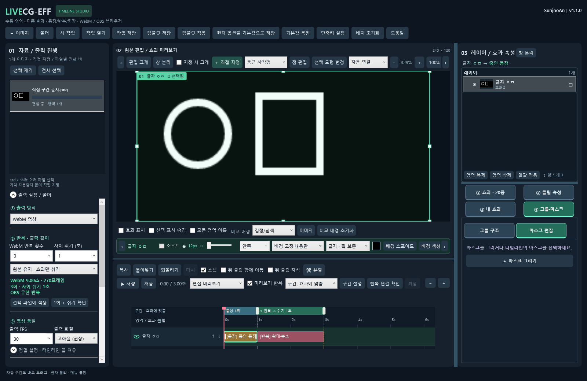
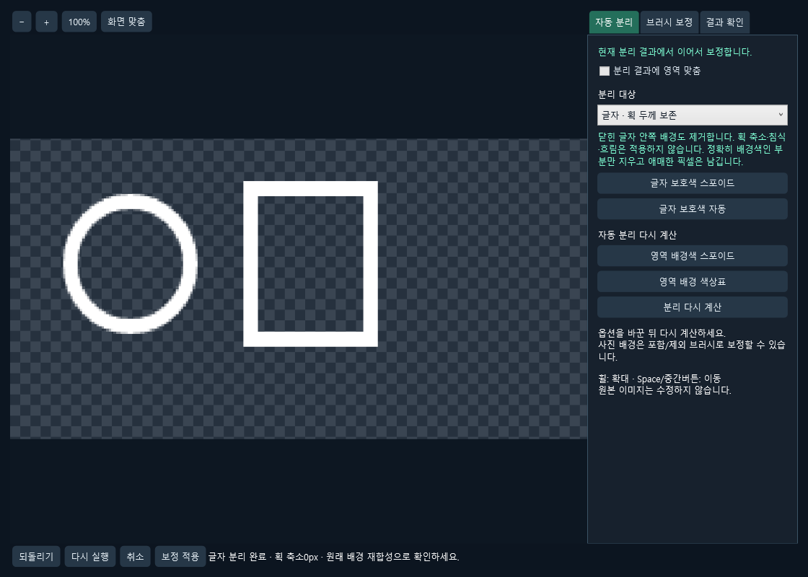
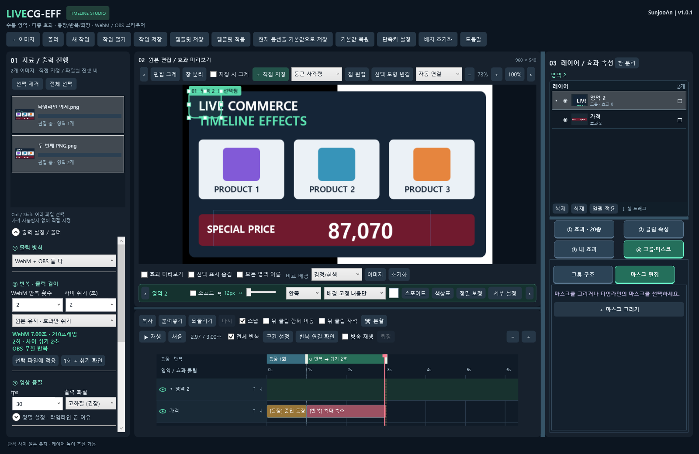

# LiveCG-EFF

**제작자 SunjooAn · 현재 버전 1.5.2 · Windows x64**

이미지에서 마우스로 지정한 영역에 효과를 배치하고 **투명 WebM / OBS 브라우저 패키지**로 출력하는 라이브커머스 자막 편집기입니다. 가격 자동 탐지와 사운드는 포함하지 않습니다.

## 다운로드와 실행

[최신 Windows 배포](https://github.com/sunjoo1968-design/LiveCG-EFF/releases/latest)에서 **LiveCG-EFF-1.5.2-win-x64.zip**을 받아 압축을 풀고 최상단 **LiveCG-EFF.exe**를 실행하세요. app / 사용안내 / licenses 폴더를 함께 보관하세요. .NET·SkiaSharp·FFmpeg가 포함되어 별도 런타임 설치가 필요하지 않습니다.

## v1.5.2 OBS 프리뷰 가격 표시

숫자 롤링 자료가 OBS 스튜디오 모드의 프리뷰에서 대기할 때 원본 가격을 표시합니다. 프로그램 화면으로 전환하면 설정에 따라 숫자 롤링을 처음부터 재생합니다. 기존 브라우저 소스에는 앱에서 작업을 열고 **저장·방송 갱신**을 한 번 실행해 적용하세요.

## v1.5.1 같은 폴더에 저장·방송 갱신

1. 최초에는 이미지 추가 → 효과 적용 → 좌측 출력 설정에서 OBS 출력 → 작업 저장을 합니다. OBS에는 각 출력 폴더의 **index.html**을 등록합니다.
2. 다른 PC로 옮길 때는 작업 파일·원본·출력 폴더를 함께 압축하세요. **작업 → 이동용 작업 저장**으로 함께 모을 수도 있습니다. 옮긴 작업을 열면 원본과 출력 위치를 찾습니다.
3. OBS 장면 경로도 달라졌다면 **작업 → 다른 PC OBS 연결**에서 OBS가 내보낸 장면 JSON을 선택합니다. 생성된 _연결.json 사본을 OBS에서 불러옵니다. 브라우저 index 경로를 연결하며 다른 미디어 경로는 수정하지 않습니다.
4. 방송 중에는 **작업 열기 → 이미지 교체 → 미리보기 확인 → 저장·방송 갱신**을 사용합니다. 작업과 연결된 출력 폴더를 한 번에 갱신하며 OBS는 같은 파일에서 새 자료를 읽습니다.

최초 출력부터 index.html은 자동 갱신을 지원합니다. 이전 버전에서 만든 출력은 새 버전으로 한 번 갱신한 뒤 OBS 소스를 새로고침해야 합니다. 이후에는 다시 등록하지 않아도 됩니다.

작업 파일을 별도 하위 폴더에 저장해도 원본·출력을 상위 상대 경로로 기록합니다. 이동용 저장 위치는 기존 출력 폴더 바깥으로 선택하세요.

출력 폴더를 작업에 기록하며 상대 위치, 출력 ID와 이전 영역 ID를 이용해 이전한 자료를 찾습니다. 자료 목록의 툴팁에서 연결된 출력 경로를 확인할 수 있습니다. 출력 안의 .livecg는 프로그램이 관리하며 현재·직전 두 자료만 보관합니다. 이미지 파일명이 바뀌어도 방송 진입 파일 이름을 늘리지 않습니다. 실제 보관 위치 자체를 다시 옮겼다면 작업과 OBS 장면의 경로도 연결하세요.

## v1.4.1 두 PC 사이 방송 자료 갱신

1. 작업용 PC에서 작업을 열고 PNG 교체와 효과 확인을 마칩니다. **방송 갱신 ZIP 저장**을 누르면 선택한 자료마다 ZIP이 생성되고 작업에 방송 자료 ID가 저장됩니다.
2. 방송용 PC에서 같은 앱을 실행해 **방송 자료 관리 → 보관 폴더 선택 → 갱신 ZIP 가져오기**를 사용합니다. 준비 자료 미리보기로 확인하고 **방송에 반영**을 누릅니다.
3. 최초에는 목록에서 해당 자료를 선택하고 **OBS HTML 경로 복사**로 복사한 entry.html을 OBS 브라우저의 로컬 파일로 등록합니다. 너비·높이는 관리창에 표시된 값으로 맞춥니다. OBS의 소스 종료/장면 활성화 새로고침 옵션은 끕니다.
4. 다음 수정본은 같은 작업에서 출력해 방송용 PC로 전달합니다. 원본 이름·전달 ZIP 이름·작업 폴더가 바뀌어도 방송 ID로 기존 자료를 갱신합니다. 기본은 반복 종료 후 교체이며 **즉시 교체**도 선택할 수 있습니다. 1프레임만 반복하는 효과도 반복 횟수를 기준으로 교체합니다.
5. **이전 버전 복구**는 직전 반영 자료를 다시 요청합니다. 새 상품에 같은 효과를 쓰려면 **새 방송 자료로 복제**해 새 ID를 만든 뒤 이미지 교체와 작업 저장을 진행합니다.

기존 OBS 패키지는 계속 사용할 수 있습니다. 방송 갱신 기능을 처음 적용할 때에는 관리창이 제공하는 새 entry.html을 OBS에 한 번 등록해야 합니다. 방송용 보관 폴더 자체를 이동하면 OBS 로컬 파일 경로를 다시 연결해야 합니다. 이름과 크기가 달라진 이미지는 반영 전 확인하세요.

작업 저장 시 원본 파일 지문도 기록합니다. 작업 폴더 안에서 하위 폴더명이나 파일명이 바뀌면 같은 내용의 원본을 다시 찾습니다. 내용까지 바뀐 파일은 원본 다시 연결 또는 이미지 교체로 지정하세요.

작업 파일을 보관해야 방송 ID가 다음 수정에도 유지됩니다. 이미지를 새로 가져오면 새 자료로 생성됩니다. 관리 도구는 ZIP을 검사하고 새 버전을 준비한 후 반영하며, OBS에는 준비가 끝난 화면을 교체합니다. 방송용 PC에서 관리창을 닫아도 고정 HTML의 갱신 감지는 계속 동작합니다. 이전 출력 자료는 보관 폴더에 남습니다.

## v1.3.0 작업 이동과 자료 교체

- **이동용 작업 저장**으로 생성한 폴더 전체를 다른 PC에 복사한 뒤 안의 작업 파일을 여세요.
- 자료 목록을 우클릭해 **원본 다시 연결**, **누락 원본 폴더 지정**, **원본 이미지 교체**를 사용할 수 있습니다. 교체 시 영역과 클립은 유지되고, 이미지에 맞춰 만든 분리 마스크와 숫자 경계는 새 이미지 기준으로 다시 계산합니다.
- 타임라인에 포커스를 둔 채 **←/→**로 선택 클립을 1프레임씩 이동합니다. 출력 옵션은 **최종 출력 설정**에서 펼칩니다.
- 여행 경로에 배 아이콘을 추가했습니다. 새 경로는 정차 0.5초, 좌우 방향 전환, 빨간 점선을 기본으로 사용합니다. 시간 슬라이더는 0.5초 단위이며 정밀 입력은 별도로 사용할 수 있습니다.

## v1.2.3 영역 재지정과 숫자 롤링

- 영역을 삭제하고 다시 지정했을 때 일부 순환 숫자가 잘려 보이던 문제를 수정했습니다. 좁은 원래 숫자 `1`과 넓은 임시 숫자 `0`의 표시 공간을 분리하고, 숫자 칸 편집의 자동 경계도 같은 기준으로 맞췄습니다. 사용자가 지정한 경계는 유지합니다.
- 복합 배경 분리 후 남은 배경색을 숫자 획으로 잘못 판단해 높이가 늘어나던 문제를 수정했습니다. 원래 배경색을 숫자 검출의 기준으로 사용하며 원본 획을 깎지 않습니다. 수동 칸에서 쉼표는 고정된 원본으로 남깁니다.
- OBS 브라우저 패키지에는 앱에서 그린 임시 숫자 이미지를 내장해 글꼴 표시 차이를 줄입니다. 효과가 멈추면 원본 숫자 픽셀과 획 두께를 그대로 복원합니다.
- 제공된 실제 복합 배경 이미지의 가격·할인율, 영역 삭제·재지정과 경계 ±2px, 정밀 분리·숫자 칸 편집을 검사했습니다. 동일 모델의 새 장면과 기존 장면이 같아 캐시 잔존은 확인되지 않았습니다. 실제 이미지는 공개하지 않습니다.
- 기존 작업을 열어 사용할 수 있습니다. OBS에 반영하려면 **브라우저 패키지를 다시 출력**하세요. 같은 색의 글자·배경이나 모호한 무늬는 포함/제외 브러시 보정이 필요할 수 있습니다.

## v1.2.2 숫자 롤링·분리와 정차 조절

- 정밀 분리 결과를 적용한 숫자 롤링에서 원래 글자 모양이 새 숫자를 잘라내던 문제를 수정했습니다. 분리 마스크는 입력 숫자에 적용하며, 출력에는 선택 도형과 명시한 타임라인 마스크를 적용합니다.
- **정밀 분리·보정 → 글자·획 두께 보존 → 숫자·가격 우선 · 획 보존**으로 가격·할인율 분리를 설정합니다. 보호색을 자동 추정하고 옅은 가장자리를 배경 허용오차보다 먼저 보호합니다. 여러 배경색은 **배경색 추가 · 스포이드**로 지정합니다. 획 축소·침식은 사용하지 않습니다.
- 여러 배경색으로 설명할 수 있는 모호한 가장자리는 원래 픽셀을 남깁니다. 배경과 글자가 같은 색이거나 심한 압축 잡음이 있으면 완전히 분리되지 않을 수 있으므로 포함/제외 브러시로 보정하세요. 수동 보정은 유지합니다.
- **이 지점 정차**에 슬라이더와 항상 보이는 **정밀 입력 → 초 → 적용**을 제공합니다. Enter 또는 입력을 마친 뒤 다른 곳을 눌러도 적용됩니다. 0~30초이며 출력 프레임 단위로 맞춥니다. 전체 시간보다 정차 합이 길면 기존 값을 유지하고 안내합니다.
- 지점별 이동 시간 슬라이더를 없앴습니다. **전체 시간** 안에서 정차를 제외한 시간을 궤적 길이에 맞춰 자동 계산합니다. 기존 경로도 현재 총시간을 유지해 전환합니다.
- **모든 지점 정차 중 강조 · 이름 없음**은 출발·경유·도착 각각의 정차 시간에만 원을 표시합니다. 움직이면 사라지고, 0초 정차에는 표시하지 않습니다. 도착 정차가 끝난 뒤에도 강조는 남지 않습니다.




## v1.2.1 여행 경로 편집 개선

- 새 지도는 빈 경로로 시작합니다. **직접 지정한 지도 영역 → 여행 경로**에서 우클릭으로 점을 추가합니다. 출발·경유·도착은 자동 구분하며 점 우클릭으로 역할·삭제·앞뒤 추가를 수정합니다.
- **전체 시간**에 이동과 정차를 포함합니다. 예: 10초를 지정하면 정차를 뺀 나머지를 실제 궤적 길이에 맞춰 프레임 단위로 배분합니다. 점·곡선·정차 수정에도 총시간을 유지하며, 정차가 너무 길면 값을 되돌리고 안내합니다.
- **부드러운 곡선**을 켜도 먼저 직선을 유지합니다. 선을 잡아 끌어 여러 곡선점을 만들며, 주황 곡선점에는 정차하지 않습니다. 곡선점 우클릭으로 삭제·직선 복원이 가능합니다.
- 수평·기울어진 수평 이동은 아이콘 지붕을 위로 유지하며 방향에 맞춰 좌우 전환합니다. 수직 계열은 경로 회전을 유지합니다.
- 새 경로 기본값은 예정 경로 끔, 도착 강조 켬, 전체 반복 켬입니다. 이름과 편집점은 방송에 출력하지 않습니다. 실제 효과만 보기로 확인할 수 있습니다.
- 경로는 지정한 지도 영역 크기의 독립 오버레이로 만들고, 다음에 그린 영역을 자동으로 그룹에 넣지 않습니다. 기존 프로젝트의 명시한 그룹 관계와 옵션은 유지합니다.




## v1.2.0 개선

- 흰 배경의 굵게 연결된 숫자도 숫자 칸을 분할해 롤링합니다. 영역 안쪽 테두리에서 배경을 추정하고, **클립 속성 → 숫자 칸 편집**에서 경계를 드래그·더블클릭 추가·우클릭 삭제할 수 있습니다. 칸을 찾지 못하면 속성창에 안내합니다. 멈출 때는 원본 숫자 이미지로 정착합니다. OCR/가격 자동 탐지 기능은 추가하지 않았습니다.
- **정밀 분리·보정 → 글자·획 보존 → 색상 범위·무늬 배경**을 추가했습니다. 배경색을 여러 개 찍고, 글자 보호색과 배경/글자 색상 범위를 따로 조절합니다. 정확한 단색 방식도 유지합니다. 글자 모드는 윤곽 축소·침식·페더를 사용하지 않습니다.
- **실시간 미리보기**가 기본입니다. 설정 변경을 짧게 모아 별도 계산하고 최신 결과만 표시합니다. 되돌리기/다시 실행은 설정·색상·마스크를 함께 복구하며 Ctrl+Z / Ctrl+Y / Ctrl+Shift+Z를 지원합니다. 버튼에 작업명을 표시합니다.
- 수동 브러시 보정은 자동 분리와 별도로 저장하므로 재계산·저장 후 재편집에도 유지합니다. **브러시 보정 → 수동 보정만 초기화**로 제거합니다. 이전 버전 마스크는 자동 분리와 다른 부분을 보수적으로 수동 보정으로 유지합니다.
- 정지 프레임·분리 결과·선택 기록을 재사용하고 마스크 표시를 일괄 처리합니다. 소프트 조절선은 가벼운 표시용 계산을 사용하며 최종 출력 해상도는 유지합니다.
- 앱 시작의 출력 기본값과 메뉴 첫 항목은 **OBS 브라우저 패키지**, 재생 기본값은 **OBS 방송 미리보기**입니다. 저장된 프로젝트의 출력 선택은 유지합니다. OBS 전용 출력에서는 WebM 반복 횟수·CRF 화질을 숨기고, 공통 사이 쉬기는 유지합니다.
- 새 **여행 경로** 효과는 전용 편집창에서 지도 위 이동·정차·교통수단·궤적을 작성합니다. WebM과 OBS 브라우저에 모두 출력합니다.



## 여행 경로 만들기

1. 지도 이미지를 추가하고 **직접 지정**으로 사용할 지도 영역을 그린 뒤 **효과 → 여행 경로**를 엽니다. 기존 경로는 **클립 속성 → 여행 경로 편집**에서 수정합니다.
2. 지도 빈 곳을 **우클릭**해 점을 찍습니다. 첫 점은 출발, 마지막은 도착, 사이의 점은 경유입니다. 점은 왼쪽 드래그로 이동하고 우클릭 메뉴로 삭제·출발/도착 재지정·앞뒤 추가합니다. 선 우클릭으로 중간 경유점을 삽입합니다. 휠/＋/−/100%/화면 맞춤과 Space·중간버튼 이동을 지원합니다.
3. **경유점·시간 → 전체 시간**을 지정하면 이동+정차를 포함한 길이를 맞춥니다. 정밀 입력에 10 같은 초를 입력할 수 있습니다. 지점별 이동 시간은 궤적 길이에 맞춰 자동 계산합니다. **이 지점 정차 → 정밀 입력**에서 정확한 초를 입력할 수 있으며, 기본 정차1초·정차0초는 통과입니다. 전체 시간이 정차 합보다 짧으면 안내 후 기존 값을 유지합니다.
4. **아이콘·궤적**에서 비행기·자동차·캠핑카·자전거 또는 사용자 PNG/정적 투명 WebP를 선택합니다. 사용자 이미지는 비율을 유지하며 최대512px PNG로 내장합니다. 경로 따라 회전·좌우 전환·고정과 약한 애니메이션을 선택합니다. 수평 이동은 지붕이 위를 향합니다.
5. **부드러운 곡선**을 켜고 선 위를 왼쪽으로 잡아 끌어 구부립니다. 여러 주황 곡선점을 추가·이동·우클릭 삭제할 수 있으며 정차 지점과 다릅니다. 실선/파선/점선/화살표, 색·굵기·불투명도·외곽선, 예정선·정차 중 모든 지점 강조를 조절합니다. 이름은 편집용이며 출력하지 않습니다.
6. **실제 효과만 보기**와 재생으로 확인하고 **타임라인에 적용**합니다. 기본 **전체 반복**은 기존 등장 효과 뒤의 OBS 반복 구간에 배정합니다. 반복을 끄면 한 번 이동하고 도착 상태를 유지합니다. WebM 반복 횟수는 좌측 출력 설정에서 조정합니다.
7. **내 여행 경로로 저장**하면 내 효과에서 다시 삽입·편집·가져오기·내보내기할 수 있습니다. 다른 비율의 지도에 넣으면 전체 시간 배분도 다시 맞춥니다. 경로는 선택 지도 안의 독립 그래픽 레이어이며 원본과 다른 효과는 보존합니다. 숨김·수동 그룹 연결·마스크를 지원합니다.

경로는 최대200지점·총300초, 곡선점은 구간당32개·전체512개입니다. 지도에 이미 그려진 선·핀은 제거하지 않습니다. 선 없는 지도 원본을 쓰면 새 궤적과 겹치지 않습니다. 실제 지리 좌표나 도로 탐색 기능은 포함하지 않으며, 사용자가 찍은 지점을 따릅니다. 이번 수정은 최신 앱에서 OBS 패키지를 **다시 출력**하면 포함됩니다.

## 무늬 배경의 글자 분리

**배경 고정·내용만 → 글자·획 보존 → 정밀 분리·보정**에서 분리 방식을 **색상 범위·무늬 배경**으로 바꿉니다. 배경색 추가 스포이드로 대표 배경색들을 찍고, 글자 보호색 스포이드로 남길 글자를 찍습니다. 범위 슬라이더를 움직이면 분리 결과가 갱신됩니다. 결과 확인에서 원래 배경 재합성·차이를 비교하고 보정 적용합니다.

원본 획을 줄여 잡음을 숨기지 않습니다. 배경과 글자가 같거나 비슷한 색이면 모호한 픽셀은 남을 수 있습니다. 사진 배경의 가려진 부분을 복원하는 기능은 아니며, 포함/제외 브러시로 보정할 수 있습니다. 실시간 미리보기를 꺼도 보정 적용 시 마지막 설정으로 계산합니다.



## v1.1.0 개선

- 타임라인 위 **등장·반복 구간 바의 경계**를 마우스로 당깁니다. 반복 바의 가운데를 끌면 길이를 유지하며 이동합니다. 자동 상태에서 실제로 드래그하면 **직접 조절**로 바뀌며 **효과에 맞춤**으로 돌아갈 수 있습니다. 스냅·한 프레임 최소 길이·ESC 취소·되돌리기를 지원하며 효과 클립은 이동하지 않습니다.
- 하단 영역바의 분리 대상을 **글자·획 보존**으로 선택하면 ㅇ·ㅁ 안쪽의 배경도 제거합니다. 획 축소·침식·페더를 적용하지 않고 원본의 글자 픽셀을 보존합니다. 일반 오브젝트는 닫힌 내부 색을 보존하는 기존 동작을 유지합니다.
- **정밀 분리·보정**을 자동 분리 / 브러시 보정 / 결과 확인으로 나눴습니다. 배경색과 글자 보호색을 따로 찍고, 닫힌 안쪽 배경을 찍어 빨간 후보를 확인한 뒤 제거할 수 있습니다. **원래 배경에 재합성 / 원본과 차이**로 획을 확인합니다.
- 편집/OBS 방송 미리보기를 선택 메뉴로 통합하고, 효과·영역·마스크의 시간·반복·색상·복제/삭제 이름을 정리했습니다. 속성창의 중복 효과 목록과 중복 그룹 역할 설정을 제거했습니다.
- 기존 수동 분리 결과는 다시 계산하기 전까지 유지합니다. 원본 이미지와 저장된 작업을 덮어쓰지 않습니다. 삭제했던 출력 순서 배지 줄은 표시하지 않습니다.



### 글자 안쪽 배경 제거

1. 글자 주변을 넉넉하게 지정하고 **배경 고정·내용만**을 선택합니다.
2. 하단 영역바에서 **글자·획 보존**을 선택하고 **배경 스포이드**로 실제 배경색을 찍습니다. 좁은 창에서는 영역바를 좌우로 이동합니다.
3. 더 자세히 확인하려면 **정밀 분리·보정 → 자동 분리**에서 배경색·글자 보호색을 지정합니다. 실시간 미리보기를 끈 경우 **분리 다시 계산**을 누릅니다. 글자 모드에서는 윤곽 축소와 소프트를 사용하지 않습니다.
4. 기존 수동 마스크의 구멍만 정리하려면 **브러시 보정 → 안쪽 배경 찍기 → 표시된 배경 후보 제거**를 사용합니다. **결과 확인**에서 분리 결과·재합성·차이를 비교하고 보정 적용합니다.

정확한 단색 배경에 맞춘 보수적인 분리입니다. 배경과 다른 원본 픽셀은 남기고, 경계색은 원래 배경에 다시 합성했을 때 오차가 작은 경우에만 복원합니다. 손실 압축된 JPG의 잡음·무늬·그라데이션은 남을 수 있습니다. 배경과 완전히 같은 색의 글자는 구별할 수 없습니다. 이런 경우 원본을 확대해 브러시로 보정하세요. 자동 분리와 수동 보정을 분리해 보존합니다.



## v1.0 기능

- 좌측에서 **WebM 반복 횟수·반복 사이 쉬기·쉬는 모습**을 직접 조절합니다. 구간 설정과 연동하고 최종 길이·프레임을 즉시 표시합니다.
- 새 작업은 **반복 사이 1초 / 원본 유지·효과만 쉬기**가 기본입니다. 마지막 모습 유지·전체 투명도 선택할 수 있습니다.
- WebM은 마지막 반복 뒤 쉬기를 생략합니다. OBS는 효과와 쉬기를 계속 반복합니다.
- 선택 파일에 반복 설정만 일괄 적용하고 현재 옵션을 새 작업 기본값으로 저장할 수 있습니다. **1회 + 쉬기 확인**과 **출력 예정 목록 확인**을 제공합니다.
- OBS 방송용 HTML을 **원본명_index.html**, 확인용을 **원본명_preview.html**로 출력합니다. 좌측 **OBS 파일 위치**로 방송용 파일을 찾습니다.
- PNG·JPG/JPEG·BMP·정적 WebP를 입력합니다. JPEG 회전 정보를 적용하며 원본 이미지를 수정하지 않습니다. 출력의 내부 이미지는 실제 PNG로 저장합니다.
- 새 영역은 **배경 고정·내용만 효과 적용**이 기본입니다. 소프트와 정밀 분리·보정은 별도로 조절합니다.
- 편집/타임라인과 우측 패널의 크기 조절은 잠갔습니다. **레이어 목록 높이 조절·내부 스크롤·높이 기억은 유지**합니다. 전체 프로그램 창은 크기를 바꿀 수 있습니다.
- 좌측 출력 설정을 출력 방식 / 반복·출력 길이 / 영상 품질 / 저장·출력 대상 / 실행·진행으로 구분합니다. 작은 창에서도 자료 목록 공간을 확보합니다.



## 기본 작업

1. 이미지 여러 개를 드래그하거나 **이미지 / 폴더**로 등록합니다.
2. **＋ 직접 지정**에서 사각형·원/타원·둥근 사각형·자유손·포인트 펜을 선택합니다. 도형 선택은 다음 그리기에 적용합니다. 기존 도형은 선택 도형 변경이나 점 편집으로 수정합니다.
3. 효과 썸네일을 고르고 **뒤에 추가 / 커서에 추가**로 같은 영역에 효과를 여러 개 배치합니다.
4. 구간 설정에서 효과들을 등장·반복·선택형 퇴장에 배정합니다. 기본은 효과 기준 자동 구간입니다. 타임라인 구간 바를 직접 끌거나 정밀 설정의 초·프레임으로 조절할 수도 있습니다.
5. 좌측에서 반복 횟수·쉬기를 조절하고 **1회 + 쉬기 확인**으로 점검합니다.
6. 출력 형식·화질·대상·폴더를 선택합니다. **출력 예정 목록 확인**에서 파일명·길이·동명 충돌을 확인한 뒤 출력합니다. 자료 우클릭으로 해당 파일만 출력할 수도 있습니다.

PNG·투명 WebP의 알파를 유지합니다. JPEG/BMP에 없던 투명 배경은 자동으로 생기지 않으며 분리·마스크로 지정해야 합니다. EXIF 회전이 있는 JPEG는 회전 후의 표시 크기를 사용합니다. 애니메이션 이미지·PSD/AI/SVG는 이번 입력 범위에 포함하지 않습니다.

## 반복과 쉬기

**좌측 출력 설정 → 반복·출력 길이**와 타임라인의 **구간 설정**은 같은 값을 사용합니다. WebM 반복 1~100회, 사이 쉬기 0~30초를 선택합니다. 실제 시간은 선택 FPS의 프레임 간격에 맞춥니다.

- **원본 유지**: 효과·마스크·숨김 상태와 무관하게 입력 이미지 전체를 그대로 보여줍니다.
- **마지막 모습 유지**: 반복 효과 마지막 프레임을 유지합니다.
- **전체 투명**: 쉬는 동안 출력 전체가 투명합니다.

WebM 총길이 = 등장 + 반복 길이×횟수 + 사이 쉬기×(횟수−1) + 선택형 퇴장.

예: 등장1초 + 반복2초×3회 + 사이 쉬기1초×2회 = **9초 / 30fps에서270프레임**. 반복1회이면 사이 쉬기를 넣지 않습니다. OBS 브라우저는 등장 한 번 뒤 반복+쉬기를 무한 재생합니다. 퇴장 요청은 현재 효과를 마치고 들어가며 쉬는 중 요청하면 즉시 퇴장합니다.

**끝 여유**는 편집 타임라인의 뒤 여백이며 반복 사이 쉬기와 별도입니다. 좌측 정밀 설정에 있습니다. 편집 시간과 최종 반복 출력 시간은 별도로 표시됩니다. 기존 프로젝트에서 새 쉬기 항목이 없으면0초로 읽어 기존 재생을 유지합니다. 이전 기본값 파일에는 새 작업용1초 쉬기를 보완하며 사용자가 v1.0에서 저장한0초는 유지합니다.

## 영역·레이어·모션

상·하단 도구줄은 한 줄이며 좁은 화면에서는 양 끝 화살표나 휠로 좌우 이동합니다. 소프트 폭·방향·배경색·스포이드·정밀 보정은 하단 영역바에서 조절합니다. 세부 설정은 팝업으로 열립니다. 배경 고정은 단색 배경의 내용을 분리하며 사진의 가려진 배경을 복원하지는 않습니다. 정밀 보정은 수동 마스크를 우선해 자동 분리를 중복 적용하지 않습니다.

우측 레이어 패널은 기본 펼침입니다. 눈·잠금·이름·썸네일·효과/마스크 개수와 그룹 들여쓰기를 표시합니다. 이름은 더블클릭/F2, 순서는 같은 부모 안에서 행 드래그로 바꿉니다. 그룹 연결은 그룹·마스크 메뉴에서 지정합니다. 레이어 아래 구분선으로 목록 높이를 바꾸고 나머지는 내부 스크롤로 확인합니다.

기본 효과20종과 여행 경로 전용 효과: 서서히/아래에서/위에서/줌인/줌아웃 등장, 왼쪽부터 펼치기, 확대·축소, 바운스, 흔들림, 부유, 숫자 롤링, 빛 스윕, 광채, 반짝임, 테두리 흐름, 형광펜, 밑줄 형광펜, 원형 파동, 방사선, 원형 입자 확산. 강도는 최약·약·중·강·최강입니다. 숫자 롤링은 숫자만 선택하세요.

**내 효과 → 새 모션**에서 위치·크기·회전·불투명도·기준점·4방향 크롭에 프레임별 키를 작성하고 유저 에셋으로 저장합니다. 기존 효과 조합도 저장·삽입·가져오기·내보내기할 수 있습니다.

## OBS에 넣기

1. 출력한 **원본명.obs/원본명_index.html**을 OBS 브라우저 소스의 **로컬 파일**로 선택합니다. 소스 이름도 원본 이름으로 지정하면 구분하기 쉽습니다.
2. 너비·높이는 원본 표시 크기, 사용자 지정 FPS는 출력 FPS에 맞춥니다. 패키지 사용안내.txt에 실제 값이 있습니다.
3. **보이지 않으면 소스 종료 / 장면 활성화 시 새로고침**을 끄는 것을 권장합니다.
4. 구간 설정의 **OBS 프로그램 전환 시 처음부터 재생**을 켜고 패키지를 출력합니다. 스튜디오 모드의 프로그램 진입 이벤트에서 등장부터 재생합니다.
5. 소스 우클릭 **상호작용**에서 R=재등장, E=퇴장, Space=일시정지/계속을 사용합니다. 퇴장은 눈으로 숨기기 전에 요청하세요.

원본명_preview.html은 확인용이며 조작 버튼·체크무늬는 방송에 포함되지 않습니다. 호환용 index.html/preview.html도 포함하지만 새 소스는 이름이 붙은 파일을 선택하세요. 서버·인터넷·추가 OBS 플러그인이 필요하지 않습니다. 새 글자 분리와 변경한 구간을 방송에 적용하려면 **v1.2.0에서 패키지를 다시 출력**하세요. 런타임은 함께 포함됩니다.

같은 브라우저 소스를 여러 장면에서 공유해 프로그램에서 계속 활성인 경우 새 진입 이벤트가 없을 수 있습니다. 장면별 별도 소스를 쓰거나 R/API로 재시작하세요. 자동화 API는 window.LiveCG.restart()/exit()/pause()/resume()/status()이며 LiveCGControl 사용자 이벤트도 지원합니다. [OBS 공식 브라우저 소스 안내](https://obsproject.com/kb/browser-source).

## 단축키·저장

| 키 | 작업 |
|---|---|
| Ctrl+클릭 | 효과 클립 다중 선택 |
| Ctrl+C / Ctrl+V | 복사 / 커서에 붙여넣기 |
| Ctrl+Z / Ctrl+Shift+Z 또는 Ctrl+Y | 되돌리기 / 다시 실행 |
| Ctrl+K | 현재 커서에서 클립 분할 |
| R / V | 영역 그리기 / 선택 모드 |
| Tab / Shift+Tab | 다음 / 이전 영역 |
| Delete / ESC | 삭제 / 그리기·드래그 취소 |

슬라이더와 값의 ↔ 부분 드래그로 조절하며 Shift는 세밀 조절입니다. 단축키 설정에서 영역 키를 바꿀 수 있습니다. 작업·템플릿·에셋에 원본 이미지가 자동 포함되지 않으므로 함께 보관하세요. 설정·기본값은 사용자 로컬 데이터 폴더에 저장됩니다. 새 쉬기가 있는 작업은 v1.0 이상에서 사용하세요.

## 소스와 검증

Windows x64 / PowerShell이 필요합니다. bootstrap은 .tools 안에 고정된 개발 SDK·FFmpeg를 준비합니다.

```powershell
. .\tools\bootstrap.ps1
& $taskSdk build .\LiveCG-EFF.slnx --disable-build-servers -m:1 -v minimal
& $taskSdk .\tests\LiveCG.Verify\bin\Debug\net10.0\LiveCG.Verify.dll $PWD.Path --extended
& $taskSdk .\tests\LiveCG.UiVerify\bin\Debug\net10.0-windows10.0.19041.0\win-x64\LiveCG.UiVerify.dll $PWD.Path
node .\tools\verify-browser.mjs .
node .\tools\verify-program-clock.mjs .
node .\tools\verify-obs-program.mjs .
& $taskSdk .\tests\LiveCG.Verify\bin\Debug\net10.0\LiveCG.Verify.dll $PWD.Path --browser-compare
.\tools\publish.ps1
.\tools\verify-package.ps1
```

실제 브라우저 검증에는 Node24·Chrome, OBS 통합에는 OBS33 개발용 설치본이 필요합니다. 일반 배포 사용자에게는 필요하지 않습니다. OBS 검증은 별도 portable 설정을 쓰며 송출·녹화를 시작하지 않습니다. 네이티브/Canvas의 블러·글자 경계에는 소폭 차이가 있을 수 있습니다.

[검증 요약](docs/verification/v1.5.1/summary.json) · [계획](docs/01-plan/features/linked-broadcast-save.plan.md) · [설계](docs/02-design/features/linked-broadcast-save.design.md) · [검토](docs/03-analysis/linked-broadcast-save.analysis.md) · [완료 보고](docs/04-report/linked-broadcast-save.report.md)

외부 구성 요소의 제작자·라이선스는 [THIRD_PARTY_NOTICES.md](THIRD_PARTY_NOTICES.md), licenses 및 배포본의 FFmpeg/.NET 고지에 유지합니다. 개인 원본·작업·사용자 설정과 인증 정보는 공개하지 않습니다.
