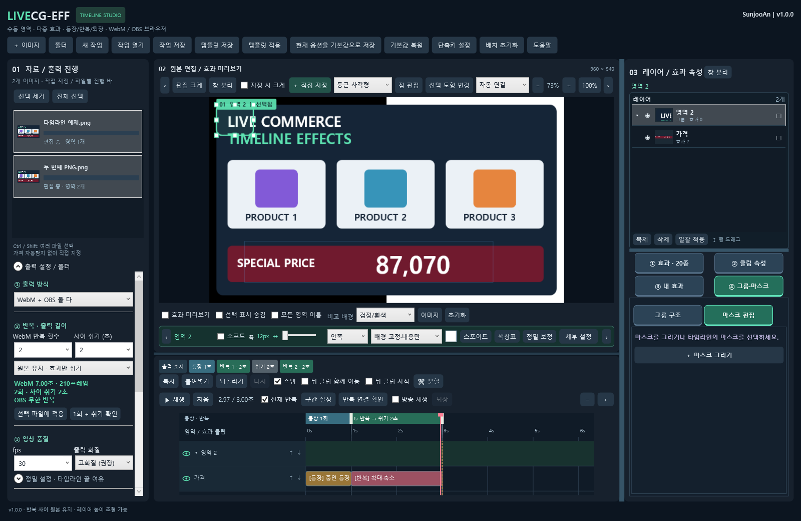

# LiveCG-EFF

**제작자 SunjooAn · 현재 버전 1.0.0 · Windows x64**

이미지에서 마우스로 지정한 영역에 효과를 배치하고 **투명 WebM / OBS 브라우저 패키지**로 출력하는 라이브커머스 자막 편집기입니다. 가격 자동 탐지와 사운드는 포함하지 않습니다.

## 다운로드와 실행

[최신 Windows 배포](https://github.com/sunjoo1968-design/LiveCG-EFF/releases/latest)에서 **LiveCG-EFF-1.0.0-win-x64.zip**을 받아 압축을 풀고 최상단 **LiveCG-EFF.exe**를 실행하세요. app / 사용안내 / licenses 폴더를 함께 보관하세요. .NET·SkiaSharp·FFmpeg가 포함되어 별도 런타임 설치가 필요하지 않습니다.

## v1.0.0 변경

- 좌측에서 **WebM 반복 횟수·반복 사이 쉬기·쉬는 모습**을 직접 조절합니다. 구간 설정과 연동하고 최종 길이·프레임을 즉시 표시합니다.
- 새 작업은 **반복 사이 1초 / 원본 유지·효과만 쉬기**가 기본입니다. 마지막 모습 유지·전체 투명도 선택할 수 있습니다.
- WebM은 마지막 반복 뒤 쉬기를 생략합니다. OBS는 효과와 쉬기를 계속 반복합니다. 타임라인 위 출력 순서 띠로 확인하세요.
- 선택 파일에 반복 설정만 일괄 적용하고 현재 옵션을 새 작업 기본값으로 저장할 수 있습니다. **1회 + 쉬기 확인**과 **출력 예정 목록 확인**을 제공합니다.
- OBS 방송용 HTML을 **원본명_index.html**, 확인용을 **원본명_preview.html**로 출력합니다. 좌측 **OBS 파일 위치**로 방송용 파일을 찾습니다.
- PNG·JPG/JPEG·BMP·정적 WebP를 입력합니다. JPEG 회전 정보를 적용하며 원본 이미지를 수정하지 않습니다. 출력의 내부 이미지는 실제 PNG로 저장합니다.
- 새 영역은 **배경 고정·내용만 효과 적용**이 기본입니다. 소프트와 정밀 분리·보정은 별도로 조절합니다.
- 편집/타임라인과 우측 패널의 크기 조절은 잠갔습니다. **레이어 목록 높이 조절·내부 스크롤·높이 기억은 유지**합니다. 전체 프로그램 창은 크기를 바꿀 수 있습니다.
- 좌측 출력 설정을 출력 방식 / 반복·출력 길이 / 영상 품질 / 저장·출력 대상 / 실행·진행으로 구분합니다. 작은 창에서도 자료 목록 공간을 확보합니다.



## 기본 작업

1. 이미지 여러 개를 드래그하거나 **이미지 / 폴더**로 등록합니다.
2. **＋ 직접 지정**에서 사각형·원/타원·둥근 사각형·자유손·포인트 펜을 선택합니다. 도형 선택은 다음 그리기에 적용합니다. 기존 도형은 선택 도형 변경이나 점 편집으로 수정합니다.
3. 효과 썸네일을 고르고 **뒤에 추가 / 커서에 추가**로 같은 영역에 효과를 여러 개 배치합니다.
4. 구간 설정에서 효과들을 등장·반복·선택형 퇴장에 배정합니다. 기본은 효과 기준 자동 구간입니다. 정밀 설정에서 초·프레임으로 조절할 수도 있습니다.
5. 좌측에서 반복 횟수·쉬기를 조절하고 **1회 + 쉬기 확인**으로 점검합니다.
6. 출력 형식·화질·대상·폴더를 선택합니다. **출력 예정 목록 확인**에서 파일명·길이·동명 충돌을 확인한 뒤 출력합니다. 자료 우클릭으로 해당 파일만 출력할 수도 있습니다.

PNG·투명 WebP의 알파를 유지합니다. JPEG/BMP에 없던 투명 배경은 자동으로 생기지 않으며 분리·마스크로 지정해야 합니다. EXIF 회전이 있는 JPEG는 회전 후의 표시 크기를 사용합니다. 애니메이션 이미지·PSD/AI/SVG는 이번 입력 범위에 포함하지 않습니다.

## 반복과 쉬기

**좌측 출력 설정 → 반복·출력 길이**와 타임라인의 **구간 설정**은 같은 값을 사용합니다. WebM 반복 1~100회, 사이 쉬기 0~30초를 선택합니다. 실제 시간은 선택 FPS의 프레임 간격에 맞춥니다.

- **원본 유지**: 효과·마스크·숨김 상태와 무관하게 입력 이미지 전체를 그대로 보여줍니다.
- **마지막 모습 유지**: 반복 효과 마지막 프레임을 유지합니다.
- **전체 투명**: 쉬는 동안 출력 전체가 투명합니다.

WebM 총길이 = 등장 + 반복 길이×횟수 + 사이 쉬기×(횟수−1) + 선택형 퇴장.

예: 등장1초 + 반복2초×3회 + 사이 쉬기1초×2회 = **9초 / 30fps에서270프레임**. 반복1회이면 사이 쉬기를 넣지 않습니다. OBS 브라우저는 등장 한 번 뒤 반복+쉬기를 무한 재생합니다. 퇴장 요청은 현재 효과를 마치고 들어가며 쉬는 중 요청하면 즉시 퇴장합니다.

**끝 여유**는 편집 타임라인의 뒤 여백이며 반복 사이 쉬기와 별도입니다. 좌측 정밀 설정에 있습니다. 편집 시간과 최종 반복 출력 시간은 별도로 표시됩니다. 기존 프로젝트에서 새 쉬기 항목이 없으면0초로 읽어 기존 재생을 유지합니다. 이전 기본값 파일에는 새 작업용1초 쉬기를 보완하며 사용자가 v1.0에서 저장한0초는 유지합니다.

## 영역·레이어·모션

상·하단 도구줄은 한 줄이며 좁은 화면에서는 양 끝 화살표나 휠로 좌우 이동합니다. 소프트 폭·방향·배경색·스포이드·정밀 보정은 하단 영역바에서 조절합니다. 세부 설정은 팝업으로 열립니다. 배경 고정은 단색 배경의 내용을 분리하며 사진의 가려진 배경을 복원하지는 않습니다. 정밀 보정은 수동 마스크를 우선해 자동 분리를 중복 적용하지 않습니다.

우측 레이어 패널은 기본 펼침입니다. 눈·잠금·이름·썸네일·효과/마스크 개수와 그룹 들여쓰기를 표시합니다. 이름은 더블클릭/F2, 순서는 같은 부모 안에서 행 드래그로 바꿉니다. 그룹 연결은 그룹·마스크 메뉴에서 지정합니다. 레이어 아래 구분선으로 목록 높이를 바꾸고 나머지는 내부 스크롤로 확인합니다.

기본 효과20종: 서서히/아래에서/위에서/줌인/줌아웃 등장, 왼쪽부터 펼치기, 확대·축소, 바운스, 흔들림, 부유, 숫자 롤링, 빛 스윕, 광채, 반짝임, 테두리 흐름, 형광펜, 밑줄 형광펜, 원형 파동, 방사선, 원형 입자 확산. 강도는 최약·약·중·강·최강입니다. 숫자 롤링은 숫자만 선택하세요.

**내 효과 → 새 모션**에서 위치·크기·회전·불투명도·기준점·4방향 크롭에 프레임별 키를 작성하고 유저 에셋으로 저장합니다. 기존 효과 조합도 저장·삽입·가져오기·내보내기할 수 있습니다.

## OBS에 넣기

1. 출력한 **원본명.obs/원본명_index.html**을 OBS 브라우저 소스의 **로컬 파일**로 선택합니다. 소스 이름도 원본 이름으로 지정하면 구분하기 쉽습니다.
2. 너비·높이는 원본 표시 크기, 사용자 지정 FPS는 출력 FPS에 맞춥니다. 패키지 사용안내.txt에 실제 값이 있습니다.
3. **보이지 않으면 소스 종료 / 장면 활성화 시 새로고침**을 끄는 것을 권장합니다.
4. 구간 설정의 **OBS 프로그램 전환 시 처음부터 재생**을 켜고 패키지를 출력합니다. 스튜디오 모드의 프로그램 진입 이벤트에서 등장부터 재생합니다.
5. 소스 우클릭 **상호작용**에서 R=재등장, E=퇴장, Space=일시정지/계속을 사용합니다. 퇴장은 눈으로 숨기기 전에 요청하세요.

원본명_preview.html은 확인용이며 조작 버튼·체크무늬는 방송에 포함되지 않습니다. 호환용 index.html/preview.html도 포함하지만 새 소스는 이름이 붙은 파일을 선택하세요. 서버·인터넷·추가 OBS 플러그인이 필요하지 않습니다. 이번 반복/쉬기 기능을 쓰려면 **v1.0에서 패키지를 다시 출력**하세요. 런타임은 함께 포함됩니다.

같은 브라우저 소스를 여러 장면에서 공유해 프로그램에서 계속 활성인 경우 새 진입 이벤트가 없을 수 있습니다. 장면별 별도 소스를 쓰거나 R/API로 재시작하세요. 자동화 API는 window.LiveCG.restart()/exit()/pause()/resume()/status()이며 LiveCGControl 사용자 이벤트도 지원합니다. [OBS 공식 브라우저 소스 안내](https://obsproject.com/kb/browser-source).

## 단축키·저장

| 키 | 작업 |
|---|---|
| Ctrl+클릭 | 효과 클립 다중 선택 |
| Ctrl+C / Ctrl+V | 복사 / 커서에 붙여넣기 |
| Ctrl+Z / Ctrl+Shift+Z 또는 Ctrl+Y | 되돌리기 / 다시 실행 |
| Ctrl+K | 현재 커서에서 클립 분할 |
| R / V | 영역 그리기 / 선택 모드 |
| Tab / Shift+Tab | 다음 / 이전 영역 |
| Delete / ESC | 삭제 / 그리기·드래그 취소 |

슬라이더와 값의 ↔ 부분 드래그로 조절하며 Shift는 세밀 조절입니다. 단축키 설정에서 영역 키를 바꿀 수 있습니다. 작업·템플릿·에셋에 원본 이미지가 자동 포함되지 않으므로 함께 보관하세요. 설정·기본값은 사용자 로컬 데이터 폴더에 저장됩니다. 새 쉬기가 있는 작업은 v1.0 이상에서 사용하세요.

## 소스와 검증

Windows x64 / PowerShell이 필요합니다. bootstrap은 .tools 안에 고정된 개발 SDK·FFmpeg를 준비합니다.

```powershell
. .\tools\bootstrap.ps1
& $taskSdk build .\LiveCG-EFF.slnx --disable-build-servers -m:1 -v minimal
& $taskSdk .\tests\LiveCG.Verify\bin\Debug\net10.0\LiveCG.Verify.dll $PWD.Path --extended
& $taskSdk .\tests\LiveCG.UiVerify\bin\Debug\net10.0-windows10.0.19041.0\win-x64\LiveCG.UiVerify.dll $PWD.Path
node .\tools\verify-browser.mjs .
node .\tools\verify-program-clock.mjs .
node .\tools\verify-obs-program.mjs .
& $taskSdk .\tests\LiveCG.Verify\bin\Debug\net10.0\LiveCG.Verify.dll $PWD.Path --browser-compare
.\tools\publish.ps1
.\tools\verify-package.ps1
```

실제 브라우저 검증에는 Node24·Chrome, OBS 통합에는 OBS33 개발용 설치본이 필요합니다. 일반 배포 사용자에게는 필요하지 않습니다. OBS 검증은 별도 portable 설정을 쓰며 송출·녹화를 시작하지 않습니다. 네이티브/Canvas의 블러·글자 경계에는 소폭 차이가 있을 수 있습니다.

[검증 요약](docs/verification/v1.0.0/summary.json) · [계획](docs/01-plan/features/v1-output-workflow.plan.md) · [설계](docs/02-design/features/v1-output-workflow.design.md) · [검토](docs/03-analysis/v1-output-workflow.analysis.md) · [완료 보고](docs/04-report/v1-output-workflow.report.md)

외부 구성 요소의 제작자·라이선스는 [THIRD_PARTY_NOTICES.md](THIRD_PARTY_NOTICES.md), licenses 및 배포본의 FFmpeg/.NET 고지에 유지합니다. 개인 원본·작업·사용자 설정과 인증 정보는 공개하지 않습니다.
