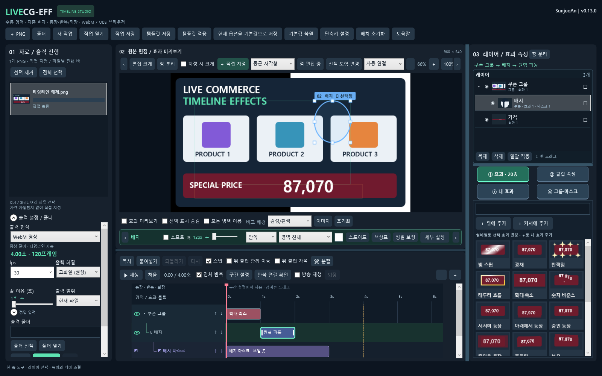
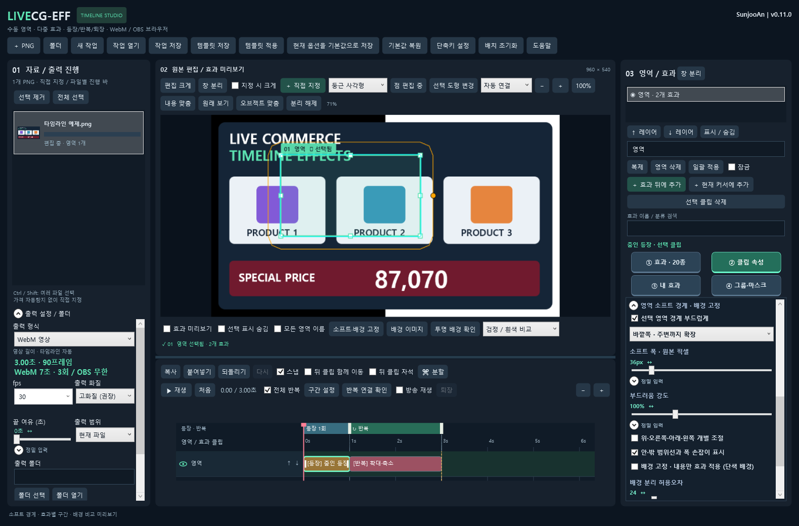
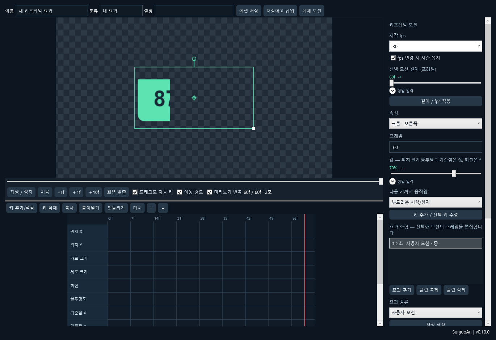

# LiveCG-EFF

**제작자 SunjooAn · 현재 버전 0.13.0 · Windows x64**

PNG에 직접 지정한 영역별 효과를 배치해 라이브커머스용 **투명 WebM**과 **OBS 브라우저 패키지**를 만드는 데스크톱 편집기입니다. 원본 크기와 파일명을 유지하며, 가격·할인율 자동 탐지 없이 마우스로 영역을 선택합니다. 효과 사운드는 포함하지 않습니다.

## 다운로드와 실행

[최신 Windows 배포](https://github.com/sunjoo1968-design/LiveCG-EFF/releases/latest)에서 다음 파일을 받으세요.

- **LiveCG-EFF-0.13.0-win-x64.zip**: 프로그램 전체. 압축을 풀고 맨 위의 **LiveCG-EFF.exe**를 실행합니다.

최신 앱에서 OBS 브라우저 패키지를 새로 출력하면 런타임도 함께 포함됩니다. 이번 버전의 구간·소프트·배경 고정은 기존 패키지에 스크립트만 덮어쓰지 말고 **패키지를 다시 출력**하세요.

.NET 런타임·SkiaSharp·FFmpeg를 포함합니다. **app / 사용안내 / licenses 폴더를 함께 보관**하세요. EXE만 따로 옮기면 실행할 수 없습니다. 소스 저장소에는 생성된 실행 파일과 개인 방송 자료를 넣지 않습니다.

## v0.13.0의 변경

- **상단 한 줄 도구**: 그리기 설정의 접기를 없애고 도형·점 편집·연결 방식·확대를 한 줄에 배치했습니다. 좁은 창은 양 끝 화살표나 마우스 휠로 좌우 이동합니다.
- **하단 한 줄 영역바**: 영역 이름·소프트·폭·방향·배경 고정·색·스포이드·정밀 보정을 바로 조절합니다. 접기·고정·영역바 별도 창을 제거했습니다. 강도·4변·허용오차 등은 **세부 설정 팝업**으로 열어 편집 공간을 유지합니다.
- **항상 펼친 레이어 목록**: 우측 상단에 썸네일·표시/숨김·잠금·이름·효과/마스크 개수를 표시합니다. 그룹 안 영역은 들여쓰고 그룹 화살표로 접습니다. 캔버스·타임라인과 같은 선택을 공유합니다.
- **직접 레이어 관리**: 이름 더블클릭/F2·우클릭으로 이름을 바꾸고 행 드래그로 같은 그룹 안의 순서를 조절합니다. 그룹 변경은 그룹·마스크 메뉴에서 명시적으로 연결합니다. 눈·잠금·이름·순서 변경은 되돌리기를 지원합니다.
- **높이·너비 조절과 기억**: 레이어 아래 가로 구분선을 드래그해 목록 높이를, 우측 패널 왼쪽 세로 구분선으로 너비를 바꿉니다. 목록은 내부 스크롤과 가상화를 사용하며, 재실행 시 크기를 복원합니다. **배치 초기화**로 기본 크기로 돌아옵니다.
- **호환성**: 원본 편집·효과 속성의 창 분리는 유지합니다. 이전 영역바 별도 창/접기 설정은 무시합니다. 기존 작업과 WebM/OBS 렌더링은 유지합니다.

소프트는 선택틀의 경계, 정밀 보정의 브러시·색 번짐 정리는 실제 오브젝트 윤곽을 조절합니다. 수동 보정 후 자동 분리를 중복 적용하지 않으며 원래 선택 범위를 유지하는 것이 기본입니다. 전체 영역 모드로 바꾸어도 수동 마스크를 보관해 다시 활성화할 수 있습니다. **자동 분리로 되돌리기**는 수동 마스크를 지우며 Ctrl+Z로 복원할 수 있습니다.

클립 속성의 기본 / 시간·반복·구간 / 색상·모양 분류, 그룹 구조 / 마스크 편집 내부 탭, 관련 항목만 표시, 기본 효과와 내 효과의 독립 검색은 v0.12에서 유지했습니다.



v0.13.0 검증: **코어431 + WPF368 + Chromium81 + 시계5 + 실제 OBS33 통합24 + 렌더 비교59 =968/968 통과**. [검증 요약](docs/verification/v0.13.0/summary.json). 작은 화면에서는 도구줄 좌우 이동과 **편집 크게**를 활용하세요. 이번 UI 개편만을 위해 기존 OBS 패키지를 다시 출력할 필요는 없습니다.

## v0.11.0에서 유지한 개선

- **효과 기준 구간**: 구간 창에서 Ctrl/Shift로 효과를 여러 개 골라 등장·반복·퇴장에 배정합니다. 기본 자동 분류는 등장 효과→등장, 나머지→반복이며 명시 배정이 우선합니다. 클립 길이 변경을 구간 경계가 따라갑니다.
- **선택형 퇴장**: 새 작업은 등장·반복 사용, 퇴장 끔입니다. 기존 작업은 기존 재생 정책을 유지합니다. 퇴장을 끄면 해당 구간과 배정 효과가 출력에서 제외됩니다.
- **정밀 설정**: 초·프레임 입력과 수동 경계 조절을 펼쳐서 사용합니다. 정밀 시간 수정은 수동 구간 방식으로 전환합니다.
- **소프트 경계**: 안쪽·바깥쪽·양쪽, 폭·강도, 위·오른쪽·아래·왼쪽 개별 폭을 조절합니다. 원본 RGB를 흐리지 않고 알파 경계에 적용합니다.
- **범위선·드래그**: 청록색은 거의 불투명한 경계, 주황색은 바깥 투명 경계입니다. 주황 손잡이를 드래그하면 폭이 바뀝니다. 선택 표시 숨김을 켜면 안내선도 숨깁니다.
- **배경 비교**: 체크무늬·검정·흰색·검정/흰색 동시 비교·사용자 이미지를 선택합니다. 비교 배경과 안내선은 출력에 포함되지 않습니다.
- **배경 고정 · 내용만 효과 적용**: 단색 배경의 연결된 바깥 배경을 분리하고 글자·오브젝트의 원본 픽셀을 움직입니다. 내부의 닫힌 같은 색은 보호합니다. 사진·무늬의 숨겨진 배경을 복원하지는 않습니다.
- **반복 연결 확인**: 반복 마지막 프레임과 첫 프레임을 나란히 확인합니다.

편집 영역을 고르면 하단 빠른 바에서 소프트와 배경을 조절할 수 있습니다. 배경색은 **스포이드/색상표**로 지정하거나 **세부 설정 → 배경을 채우는 방식**에서 테두리색 추정을 사용합니다. 소프트가 글자에 닿지 않도록 여백을 두세요. 바깥쪽 소프트는 주변 원본 픽셀을 포함하며 PNG 가장자리에서 제한됩니다.

구간 배정은 기존 타임라인을 임의로 움직이지 않습니다. 경계를 가로지르는 효과는 경고를 확인하고 **배정 구간 순서로 효과 정렬** 또는 **구간 경계에서 효과 분할**을 사용하세요. 정렬은 구간 내 시간 간격을 유지하며 마스크 시간은 옮기지 않습니다. 타임라인 우클릭으로도 선택 효과를 배정할 수 있습니다. 새 설정이 있는 작업은 v0.11 이상에서 사용하세요.



v0.11.0 검증: **코어420 + WPF313 + Chromium73 + 재생 시계5 + 실제 OBS33 통합20 + 렌더 비교51 =882/882 통과**. [검증 요약](docs/verification/v0.11.0/summary.json).

## v0.10.0에서 유지한 개선

- OBS Studio Mode의 **프리뷰 표시**와 **프로그램 활성화**를 구분해 프로그램 진입 시 등장부터 다시 재생합니다.
- 빛 스윕이 PNG의 투명 여백을 칠하는 문제와 확대·축소 이후 원형 파동의 흰 경계를 수정했습니다.
- **최약 / 약 / 중 / 강 / 최강** 5단계입니다. 기존 약·중·강의 세기는 유지합니다.
- **왼쪽부터 펼치기**, **위에서 등장**, **밑줄 형광펜**을 더해 기본 효과가 20종입니다.
- 장식 색상·투명도, 색상표·원본 스포이드·기본색 복원을 제공합니다.
- 새 모션은 숫자 샘플과 **빈 키프레임**으로 시작합니다. 위·아래·왼쪽·오른쪽 **크롭**을 포함한 12개 채널을 편집합니다.
- 우측 4탭은 큰 버튼과 고정된 2×2 순서로 표시합니다.

## 기본 작업

1. PNG 여러 개를 드래그하거나 **PNG / 폴더**로 등록합니다.
2. **＋ 직접 지정**에서 사각형·원/타원·둥근 사각형·자유손·포인트 펜을 골라 영역을 만듭니다. 도형 선택은 다음 그리기에만 적용됩니다.
3. 영역을 선택하고 효과를 추가합니다. 같은 영역에 여러 클립을 순차 배치할 수 있습니다.
4. 타임라인 본체 드래그로 이동, 양끝 드래그로 길이를 조절합니다. 스냅·뒤 클립 함께 이동·뒤 클립 자석을 선택합니다.
5. 왼쪽에서 출력 형식·fps·화질·범위·폴더를 지정합니다. 자료 우클릭으로 현재 파일·선택 파일을 출력할 수도 있습니다.

원본 편집 화면은 휠/＋/−/100%/내용 맞춤으로 확대합니다. Space 또는 중간 버튼 드래그로 이동합니다. **편집 크게**는 타임라인을 접고, **창 분리**는 별도 창으로 뽑습니다. **선택 표시 숨김**은 방송에 표현될 효과만 보여줍니다. 체크무늬는 투명 영역을 확인하는 배경이며 출력에 들어가지 않습니다.

## 영역·레이어·그룹·마스크

위 행이 위 레이어입니다. 눈 아이콘으로 숨기고, 위/아래 버튼이나 행 드래그로 순서를 바꿉니다. 큰 쿠폰은 **전체 묶음**, 그 안의 배지 등은 **묶음 안 부분 효과**로 연결하면 원본을 중복 표시하지 않고 함께 움직일 수 있습니다. 독립 객체는 각각 원본을 소유합니다.

**정밀 분리·보정**은 현재 분리 결과에서 내부 같은 색 보호, 허용오차, 윤곽 축소·색 번짐 제거와 채우기/지우기 브러시를 사용합니다. 브러시는 원형 반경과 중심을 표시하며 **[ / ]**로 크기를 바꿉니다. Shift는 큰 단위입니다. 자동으로 범위를 줄이지 않으며 사진에 가려진 배경을 복원하는 기능은 아닙니다.

마스크는 타임라인 하위 행에 배치합니다. 보일 곳/가릴 곳/겹친 곳·반전·불투명도·경계·시간·움직임을 조절합니다. 기본은 소유 영역의 효과 구간에 적용하고 구간이 끝나면 원본으로 복귀합니다. 별도 마스크 편집창에서 확대·이동·크기·회전·기준점을 마우스로 편집합니다. 포인트 펜 경로는 점 편집으로 이동·추가·삭제할 수 있습니다. 현재 펜은 직선 포인트 방식입니다.

## 효과와 내 효과

| 종류 | 기본 효과 |
|---|---|
| 등장 | 서서히 등장, 아래에서 등장, 위에서 등장, 줌인 등장, 줌아웃 등장, 왼쪽부터 펼치기 |
| 움직임 | 확대·축소, 숫자 바운스, 흔들림, 부유 |
| 장식 | 빛 스윕, 광채, 반짝임, 테두리 흐름, 형광펜, 밑줄 형광펜, 원형 파동, 방사선, 원형 입자 확산 |
| 숫자 | 숫자 롤링 |

클립 속성에서 강도·속도·클립 안 반복·반복 주기를 고릅니다. **효과 색상**은 장식의 색과 투명도를 바꾸고 **기본색**은 고유색으로 복원합니다. 숫자 롤링은 숫자만 좁게 선택하세요. ‘원’ 단위 자동 보존과 OCR 자동 선택은 포함하지 않습니다.

**내 효과 → 새 모션**에서 위치·크기·회전·불투명도·기준점·4방향 크롭에 프레임별 키를 넣습니다. 슬라이더/↔ 드래그로 값을 조절하고 정밀 입력을 펼칠 수 있습니다. 크롭0%는 그대로,100%는 모두 자릅니다. 기존 효과를 조합하거나 직접 만든 모션을 사용자 에셋으로 저장·삽입·가져오기·내보내기합니다. 예제 모션은 버튼을 선택할 때만 불러옵니다.



## 등장·반복·퇴장

**구간 설정**을 적용하면 타임라인 위에 색상 바가 생깁니다. 파랑은 등장1회, 초록은 반복, 선택형 분홍은 퇴장입니다. 효과 방식에서는 배정한 클립의 끝을 추적합니다. 정밀 설정에서 초/프레임을 수정하면 수동 방식으로 바뀌고 흰 경계를 직접 드래그할 수 있습니다. 반복 시작/끝 모습이 같으면 이음새가 자연스럽습니다.

- **WebM**: 등장1회 + 선택한1~100회 반복 + 퇴장1회. OBS 미디어 소스의 루프를 켜면 이 파일 전체가 반복됩니다.
- **OBS 브라우저**: 등장1회 + 강조 무한 반복 + 요청 시 퇴장.
- **방송 재생**: 앱에서 구간 방식으로 확인하고 퇴장 버튼으로 끝냅니다.

**출력 설정의 WebM 7초 · 3회는 고정값이 아닙니다.** 타임라인 위 **구간 설정 → WebM 반복 횟수**에서 바꿉니다. 구간 창 아래쪽에 있으므로 스크롤하세요. 총길이는 등장 + 반복 구간 × 반복 횟수 + 선택형 퇴장으로 계산합니다. 예: 등장1초 + 반복2초 × 3회 =7초. OBS 브라우저 출력은 무한 반복합니다.

영상 길이는 클립·마스크 끝과 구간 길이로 자동 결정합니다. 기본 퇴장 페이드는 전체를 투명하게 합니다. 작업·템플릿·기본값에 구간과 출력 옵션을 저장할 수 있습니다.

## OBS에 넣기

1. 브라우저 출력으로 만든 **원본명.obs/index.html**을 OBS 브라우저 소스의 **로컬 파일**로 선택합니다.
2. 너비·높이는 원본 PNG, 사용자 지정 FPS는 출력 FPS로 맞춥니다. 패키지 사용안내.txt에 실제 수치가 있습니다.
3. **보이지 않으면 소스 종료 / 장면 활성화 시 새로고침**은 끄는 것을 권장합니다.
4. 앱의 구간 설정에서 **OBS 프로그램 전환 시 처음부터 재생**을 켜고 패키지를 출력합니다.
5. OBS 소스 우클릭 **상호작용**에서 **R=재등장, E=퇴장, Space=일시정지/계속**을 사용합니다. 눈으로 이미 숨긴 뒤에는 퇴장이 보이지 않으므로 먼저 E를 누르세요.

**v0.11 기능을 사용하려면 OBS 패키지를 다시 출력한 뒤 현재 페이지 캐시를 새로고침하세요.** WebM도 다시 출력해야 수정됩니다. preview.html은 조작·체크무늬 확인용이며 방송 소스에는 index.html을 넣습니다. 원본 PNG를 바꾸면 추출 자산도 다시 출력하세요. 서버·인터넷·추가 OBS 플러그인은 필요하지 않습니다.

OBS가 첫 페이지에 초기 활성 상태를 전달하지 않으면 프리뷰에서 움직일 수 있지만, 이후 프로그램 진입 이벤트에서 처음부터 재생합니다. 같은 브라우저 소스를 여러 장면이 공유해 프로그램에서 계속 활성 상태인 경우에는 새 진입 이벤트가 없으므로 **장면별 별도 소스** 또는 R/API를 사용하세요.

자동화 API는 `window.LiveCG.restart()/exit()/pause()/resume()/status()`입니다. `LiveCGControl` 사용자 이벤트의 command와 target(sourceName 또는 all)도 지원합니다. OBS 웹소켓 연결이나 플러그인을 자동 설치하지는 않습니다.

[OBS 브라우저 소스](https://obsproject.com/kb/browser-source) · [OBS 브라우저 활성화 구현](https://github.com/obsproject/obs-browser/blob/master/obs-browser-source.cpp)

## 단축키와 저장

| 키 | 작업 |
|---|---|
| Ctrl+클릭 | 클립 다중 선택 |
| Ctrl+C / Ctrl+V | 복사 / 커서에 붙여넣기 |
| Ctrl+Z / Ctrl+Shift+Z 또는 Ctrl+Y | 되돌리기 / 다시 실행 |
| Ctrl+K | 커서에서 클립 분할 |
| R / V | 영역 그리기 / 선택 모드 |
| Tab / Shift+Tab | 다음 / 이전 영역 |
| Delete / ESC | 삭제 / 현재 드래그·그리기 취소 |

단축키 설정에서 영역 키를 바꿉니다. 텍스트 입력 중에는 텍스트 편집을 우선합니다. 기본값은 `%LOCALAPPDATA%/LiveCG-EFF`에 저장되며 GitHub에는 올리지 않습니다. 작업/템플릿/에셋에 원본 PNG가 자동 포함되지는 않으므로 함께 보관하세요. 구버전 작업을 읽지만, 새 효과·강도·크롭이 있는 작업은 v0.10 이상에서 사용합니다.

## 소스 빌드와 검증

Windows x64와 PowerShell이 필요합니다. bootstrap이 프로젝트의 .tools 아래에 고정된 .NET10 SDK·FFmpeg를 다운로드하고 해시를 확인합니다. 바이너리 캐시·bin/obj·artifacts는 저장소에서 제외하고 필요할 때 재생성합니다.

```powershell
. .\tools\bootstrap.ps1
& $taskSdk build .\LiveCG-EFF.slnx --disable-build-servers -m:1 -v minimal
& $taskSdk .\tests\LiveCG.Verify\bin\Debug\net10.0\LiveCG.Verify.dll $PWD.Path --extended
& $taskSdk .\tests\LiveCG.UiVerify\bin\Debug\net10.0-windows10.0.19041.0\win-x64\LiveCG.UiVerify.dll $PWD.Path
node .\tools\verify-browser.mjs .
node .\tools\verify-program-clock.mjs .
node .\tools\verify-obs-program.mjs .
& $taskSdk .\tests\LiveCG.Verify\bin\Debug\net10.0\LiveCG.Verify.dll $PWD.Path --browser-compare
.\tools\publish.ps1
.\tools\verify-package.ps1
```

브라우저 검증에는 개발용 Node24·Chrome, OBS 통합에는 OBS33 설치본이 필요합니다. `LIVECG_TEST_CHROME`과 `LIVECG_OBS_INSTALL`로 경로를 지정할 수 있습니다. OBS 검증은 artifacts 안에 별도 portable 복사본을 만들며 사용자 설정을 쓰지 않고 방송·녹화를 시작하지 않습니다. 일반 사용자는 Node·Chrome·개발 SDK를 설치할 필요가 없습니다.

v0.10.0: **코어368 + 실제WPF301 + Chromium40 + 시계5 + 실제OBS33 통합14 + 렌더 비교24 =752/752 통과**, 빌드 경고0/오류0. 상세 로그·테스트 프로필은 정리했고 [검증 요약](docs/verification/v0.10.0/summary.json)을 보존했습니다. Canvas/Skia의 블러·문자 경계에는 소폭 차이가 있고 복잡한 그룹의 미리보기 속도는 PC 성능에 따릅니다. WebM 오프라인 출력은 모든 선택 FPS 프레임을 생성합니다.

## 문서와 외부 구성 요소

[계획](docs/01-plan/features/single-line-layer-panel.plan.md) · [설계](docs/02-design/features/single-line-layer-panel.design.md) · [검토](docs/03-analysis/single-line-layer-panel.analysis.md) · [완료 보고](docs/04-report/single-line-layer-panel.report.md) · [다음 버전 제안](docs/ROADMAP.md)

외부 구성 요소의 제작자·라이선스는 [THIRD_PARTY_NOTICES.md](THIRD_PARTY_NOTICES.md)와 licenses 및 배포본의 FFmpeg/.NET 고지에 유지합니다. 개인 자막·영상·작업 파일·로컬 경로와 인증 정보는 공개 대상에서 제외합니다.
